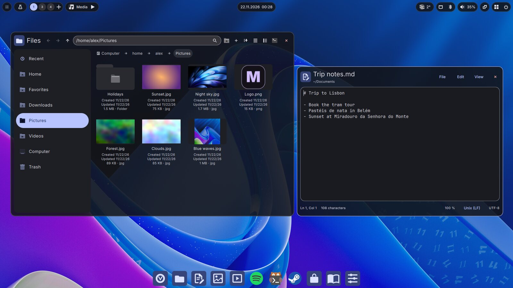
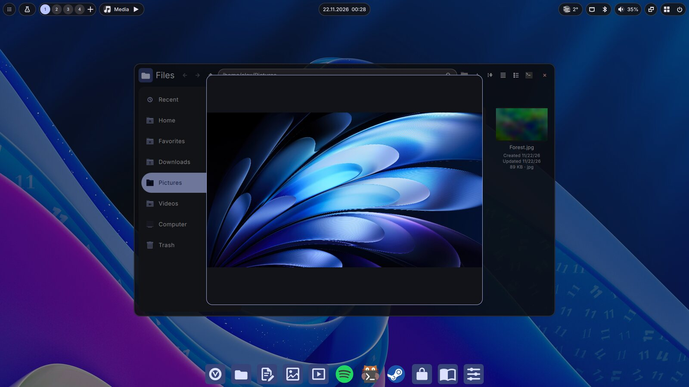
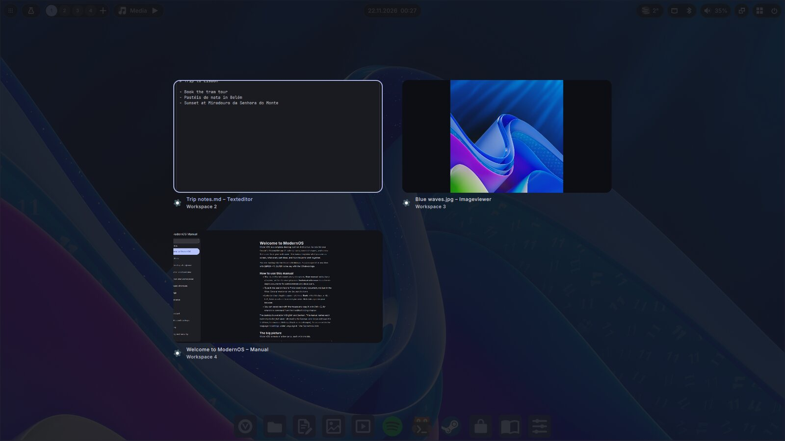
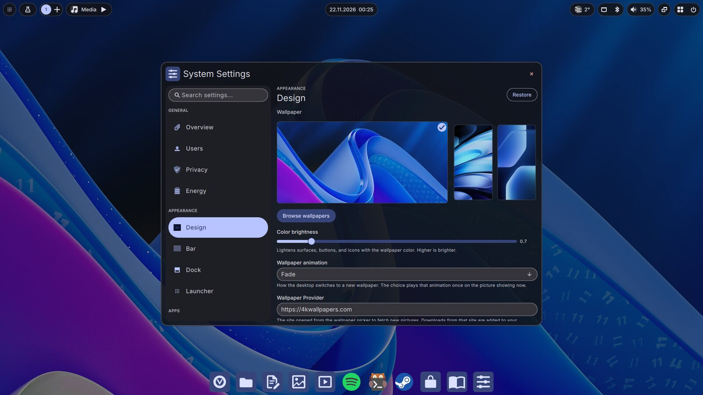
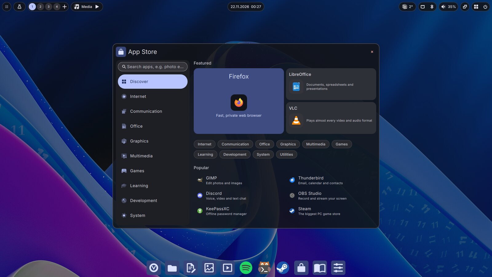
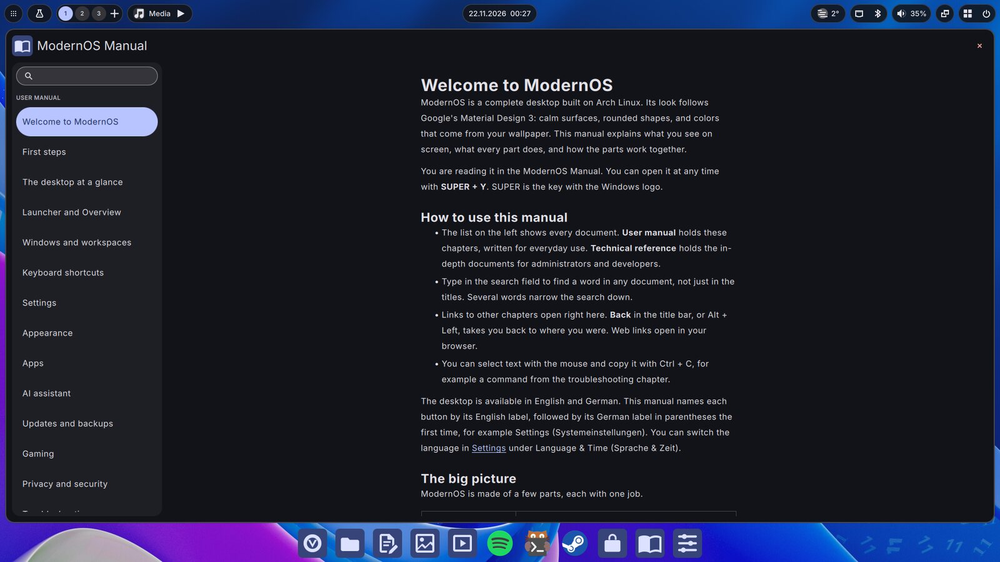
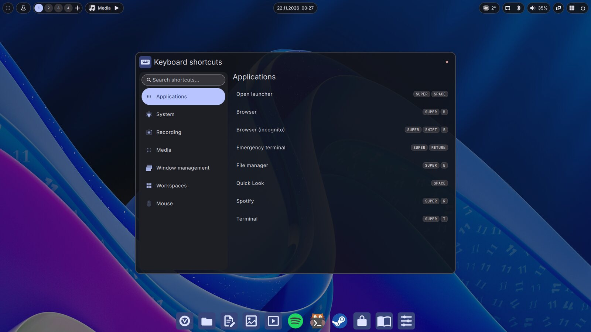

<div align="center">


# ModernOS

**A calm, modern desktop for Arch Linux.**
Material Design 3, colors that follow your wallpaper, and everything set up for you.

[](https://github.com/Gamesearch56/modern_dotfile/releases)
[](LICENSE)
[](https://archlinux.org/)
[](https://hypr.land/)
[](https://ko-fi.com/gamesearch56)

[Install](#install) · [Screenshots](#screenshots) · [Documentation](#documentation) · [Contribute](#contributing) · [Support](#support-modernos)



</div>

## What is ModernOS?

ModernOS is a ready-to-use desktop built on [Arch Linux](https://archlinux.org/)
and the [Hyprland](https://hypr.land/) window manager. You install it from a
USB stick like any other operating system, and you get a complete,
consistent desktop: a top bar, a launcher, notifications, a control panel,
a lock screen, a system settings app, an app store, and its own apps for
files, text, pictures, videos, and help.

It is made for people who like a tidy, good-looking desktop that just works,
without spending a weekend on configuration files. Everything is changed
through **System Settings**, and the whole desktop is available in
**English and German**.

## Highlights

- **Colors from your wallpaper.** Pick a wallpaper and the whole desktop
  takes on its colors: bar, panels, apps, window borders, terminal, and
  browser. Light or dark, several theme styles, or a fixed
  color.
- **Windows that arrange themselves.** New windows tile side by side
  automatically. Float, fullscreen, or move them with one shortcut or a
  mouse gesture, across ten workspaces.
- **Everything in one place.** System Settings covers displays, sound,
  network, Bluetooth, users, energy, firewall, backups, updates, gaming,
  keyboard, language, and the look of every part of the desktop. Changes
  apply instantly.
- **Its own apps.** Files, Texteditor, Imageviewer, Mediaplayer, an App
  Store to install and remove programs, and the ModernOS Manual (SUPER + Y).
- **Safe updates.** Settings > Update installs system and desktop updates
  in one go, with a snapshot taken first, so a bad update can be undone.
- **Ready for games.** Optional gaming profile with Steam, Proton and a
  game mode, plus a performance widget for the bar.
- **Optional AI assistant.** A chat on SUPER + A, with your own API key,
  stored privately on your computer.
- **Keyboard first, mouse friendly.** Every action has a shortcut (SUPER + K
  lists them all), and the mouse side buttons can move, resize and close
  windows.

## Screenshots

<table>
  <tr>
    <td width="50%"></td>
    <td width="50%"></td>
  </tr>
  <tr>
    <td align="center">Files with Quick Look (Space)</td>
    <td align="center">Every open window at a glance in the Overview</td>
  </tr>
  <tr>
    <td width="50%"></td>
    <td width="50%"></td>
  </tr>
  <tr>
    <td align="center">System Settings: wallpaper and colors</td>
    <td align="center">The App Store</td>
  </tr>
  <tr>
    <td width="50%"></td>
    <td width="50%"></td>
  </tr>
  <tr>
    <td align="center">The built-in manual (SUPER + Y)</td>
    <td align="center">Every shortcut at a glance (SUPER + K)</td>
  </tr>
</table>

The screenshots show the German interface. English is one click away in
Settings > Language & Time.

## Install

### What you need

- A 64-bit PC (x86_64) with at least **16 GB of free disk space** and 1 GB of memory
- A USB stick of at least **4 GB** (it will be erased)
- An **internet connection** during installation (Wi-Fi or cable)

> **The installer erases the disk you choose.** Back up anything you want
> to keep first. Trying ModernOS in a virtual machine (VirtualBox, GNOME
> Boxes, virt-manager) first is a good idea.

### Install from the USB stick (recommended)

1. **Download** the newest `.iso` file from the
   [Releases page](https://github.com/Gamesearch56/modern_dotfile/releases).
2. **Write it to a USB stick** with [balenaEtcher](https://etcher.balena.io/)
   or [Fedora Media Writer](https://flathub.org/apps/org.fedoraproject.MediaWriter).
   Copying the file onto the stick does not work; it has to be written as an image.
3. **Prepare your computer's firmware** (the "BIOS" setup, usually opened
   with Delete, F2 or F10 right after switching on):
   - set the boot mode to **UEFI** (turn **CSM / Legacy** off),
   - turn **Secure Boot off**. ModernOS is not signed for Secure Boot, so
     the computer would refuse to start it.
4. **Start from the stick.** Open the boot menu (often F12, F11 or Esc)
   and pick the stick's **UEFI** entry.
5. **Follow the installer.** Choose your language, time zone, keyboard,
   Wi-Fi, the disk, and your user name and password. It then installs the
   desktop and restarts.
6. **Sign in** on the ModernOS login screen. Done.

A walkthrough of every installer page, firmware keys
for each computer maker, and what to do if something goes wrong:
[First steps](docs/manual/02-first-steps.md).

### Install on an existing Arch Linux system

If you already run Arch Linux, you can install ModernOS onto your user.
Use a **release tag** (`vX.Y.Z`, see Releases), not the development branch:

```bash
git clone --branch vX.Y.Z https://github.com/Gamesearch56/modern_dotfile.git ~/modern_dotfile
cd ~/modern_dotfile
./install/install.sh --profile m0 --dry-run   # shows what it would do
./install/install.sh --profile m0
```

Then sign in through the ModernOS login screen, or start the session with
`start-hyprland`.

| Profile | What you get |
|---|---|
| `m0` | The full desktop and its apps (default) |
| `gaming` | `m0` plus Steam, Proton, and gaming tools |
| `full` | `gaming` plus a set of Flatpak apps |

The installer detects your graphics card (AMD, Intel or NVIDIA) and
processor on its own. It is safe to run again. Details and options:
[docs/INSTALL.md](docs/INSTALL.md).

## Using ModernOS

Press **SUPER + Y** at any time to open the ModernOS Manual. SUPER is the
key with the Windows logo. A few shortcuts to start with:

| Keys | What it does |
|---|---|
| SUPER + SPACE | Launcher: find and start apps |
| SUPER + I | System Settings |
| SUPER + N | Control panel: Wi-Fi, Bluetooth, volume, notifications |
| SUPER + TAB | Overview of all windows and workspaces |
| SUPER + T / B / E | Terminal / browser / files |
| SUPER + Q | Close the window |
| SUPER + 1 … 0 | Switch to workspace 1 … 10 |
| SUPER + L | Lock the screen |
| SUPER + M | Power menu: sleep, restart, shut down |
| SUPER + K | Show every shortcut |
| SUPER + Y | Open the manual |

The complete list is in [Keyboard shortcuts](docs/manual/06-keyboard-shortcuts.md).
Shortcuts can be changed in `~/.config/modern/config.json`.

### Updating

Open **Settings > Update**. ModernOS checks for new system packages and
new ModernOS releases, takes a snapshot, and installs both in one step.

## Documentation

All documentation is also built into the system: press **SUPER + Y**.

**User manual**, for everyday use:

| | |
|---|---|
| [Welcome](docs/manual/01-welcome.md) | What ModernOS is and how the parts fit together |
| [First steps](docs/manual/02-first-steps.md) | Installing, signing in, language, Wi-Fi, a first tour |
| [The desktop](docs/manual/03-desktop.md) | The bar and its widgets, control panel, notifications, dock, lock screen, screenshots |
| [Launcher and Overview](docs/manual/04-launcher-and-overview.md) | Finding apps, files and windows |
| [Windows and workspaces](docs/manual/05-windows-and-workspaces.md) | Tiling, floating, workspaces, mouse gestures |
| [Keyboard shortcuts](docs/manual/06-keyboard-shortcuts.md) | Every shortcut |
| [Settings](docs/manual/07-settings.md) | Every page of System Settings |
| [Appearance](docs/manual/08-appearance.md) | Wallpapers, colors, themes |
| [Apps](docs/manual/09-apps.md) | Files, Texteditor, Imageviewer, Mediaplayer, App Store, Manual |
| [AI assistant](docs/manual/10-assistant.md) | The chat and your privacy |
| [Updates and backups](docs/manual/11-updates-and-backups.md) | Updates, snapshots, storage |
| [Gaming](docs/manual/12-gaming.md) | Steam, Proton, game mode |
| [Privacy and security](docs/manual/13-privacy-and-security.md) | Firewall, passwords, what leaves your computer |
| [Troubleshooting](docs/manual/14-troubleshooting.md) | When something doesn't work |

**Technical reference**, for administrators and developers:
[Architecture](docs/ARCHITECTURE.md) ·
[Install internals](docs/INSTALL.md) ·
[Design system](docs/DESIGN.md) ·
[Theming](docs/THEMING.md) ·
[Settings internals](docs/SETTINGS.md) ·
[Bar widgets](docs/WIDGETS.md) ·
[Keybinds](docs/KEYBINDS.md) ·
[Boot](docs/BOOT.md) ·
[Backups](docs/BACKUP.md) ·
[Gaming](docs/GAMING.md) ·
[Translations](docs/I18N.md) ·
[Design decisions](docs/DECISIONS.md) ·
[Troubleshooting](docs/TROUBLESHOOTING.md)

## Contributing

Contributions are welcome: bug reports, translations, documentation, and
code.

- **Found a bug?** Press **SUPER + #** in ModernOS to file a report with
  the relevant logs (personal data is removed first), or open an
  [issue](https://github.com/Gamesearch56/modern_dotfile/issues/new/choose).
- **Have an idea?** Open a
  [feature request](https://github.com/Gamesearch56/modern_dotfile/issues/new/choose).
- **Want to write code?** Read [CONTRIBUTING.md](CONTRIBUTING.md) and
  [AGENTS.md](AGENTS.md) (the architecture rules), then open a pull
  request against the `dev` branch. Every pull request is reviewed by the
  maintainer before it is merged.

Security problems: please report them privately as described in
[SECURITY.md](SECURITY.md), not in a public issue.

## Support ModernOS

ModernOS is free and maintained by one person in their spare time. If you
enjoy it, you can support its development on
**[Ko-fi](https://ko-fi.com/gamesearch56)**.

[](https://ko-fi.com/gamesearch56)

**Paid feature requests:** if you need a specific feature, you can fund
its development. Open a feature request first, then get in touch through
Ko-fi to agree on the details.

## Built with

ModernOS stands on the shoulders of great open-source projects:
[Arch Linux](https://archlinux.org/),
[Hyprland](https://hypr.land/),
[Quickshell](https://quickshell.outfoxxed.me/),
[matugen](https://github.com/InioX/matugen),
[Calamares](https://calamares.io/),
[greetd](https://sr.ht/~kennylevinsen/greetd/),
[PipeWire](https://pipewire.org/), and Google's
[Material Design 3](https://m3.material.io/).

## License

ModernOS is free software under the
[GNU General Public License v3.0 or later](LICENSE). You may use, study,
share and change it; modified versions you distribute must stay under the
GPL with their source code.

[NOTICE](NOTICE) adds the terms GPLv3 section 7 allows: a modified version
keeps the credit "Based on ModernOS by Gamesearch56", is clearly marked as
changed, and uses its own name and logo. See
[TRADEMARKS.md](TRADEMARKS.md) for what you can do with the ModernOS name.
