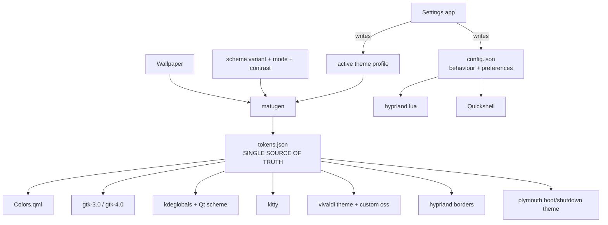

# Architecture

## Data flow



Two flows, deliberately kept separate: **colors** derive from the
wallpaper and the active theme profile; **behaviour** derives from
`config.json`. The Settings app (**System Settings**) is a Hyprland
`FloatingWindow` (title `modern.settings`) and writes JSON only, never
Lua or QML — `hyprland.lua` and the shell parse `config.json` at
load/reload. Page map, aliases, and how to add a section:
`docs/SETTINGS.md`. This one rule is what makes a GUI monitor and
keybind editor safe to build: there is no code generation step that can
produce invalid Lua.

## QML layer pattern

```
Commons/   Tokens.qml Typography.qml Motion.qml Config.qml I18n.qml Logger.qml
           — depends on nothing.

Services/  Hypr Audio Network Bluetooth Brightness Power Notifications Media
           Wallpaper SystemStats Locale Snapshots Update Weather Calendar Notes Drive Ai
           Users KdeConnect Diagnostics
           — imports Commons only. Owns ALL process spawning, IPC, D-Bus and
           filesystem access. Each file is `pragma Singleton` with a
           `Singleton { }` root and a matching line in that directory's
           `qmldir` (docs/DECISIONS.md #19).

Widgets/   MButton MIconButton MSwitch MSlider MCard MChip MListItem
           MTextField MPopup MIcon MText MDialog MTooltip MOverlay
           MSparkline MLinearProgress MSlotBoard
           — MD3 primitives. Stateless, token-driven, zero system access.

Modules/   Bar/ Launcher/ Panels/ PowerMenu/ Notifications/ Wallpaper/
           Settings/ Overview/ Session/ Cheatsheet/ Onboarding/
           — features. Composes Widgets, reads Services.
```

**Rules, enforced by `scripts/lint-layers.sh`:**

- A Module never spawns a process or touches a file — it calls a Service.
- A Service never imports a Module.
- A Widget never imports a Service or a Module.
- A Module never imports another Module's internals, only its `Module.qml`
  entry point.
- Everything a user might want to change lives in `config.json`, never
  hardcoded in QML.

## Directory layout

```
modern_dotfile/
├── AGENTS.md, README.md, LICENSE
├── .cursorrules .cursorignore .gitignore .editorconfig
├── docs/
│   ARCHITECTURE.md DESIGN.md MOTION.md DECISIONS.md INSTALL.md
│   CURSOR-SETUP.md KEYBINDS.md THEMING.md BOOT.md I18N.md WIDGETS.md
│   ISOLATION.md BACKUP.md SECURITY.md GAMING.md TROUBLESHOOTING.md
│   CUTOVER.md SETTINGS.md
├── install/
│   ├── install.sh              phased, idempotent, set -euo pipefail
│   ├── lib/                    log.sh ui.sh pkg.sh stow.sh i18n.sh preflight.sh
│   ├── manifests/               00-base 10-desktop 20-theming 30-apps
│   │                            40-dev 50-gaming 60-flatpak (+ .aur variants)
│   ├── baseline/                snapshot of the OLD user's packages, for diffing
│   └── system/                  gated: sysctl.d, greetd, tmpfiles.d, polkit,
│                                modern-usersd, plymouth theme, mkinitcpio drop-in
├── stow/
│   ├── hypr/.config/hypr/                   hyprland.lua + modules/
│   ├── shell/.config/quickshell/modern/     Commons Services Widgets Modules
│   ├── greeter/.config/quickshell/greeter/  shares Session/ with the shell
│   ├── theme/.config/matugen/               config.toml + templates/
│   ├── kitty/ dolphin/ gtk/ qt/ bash/ git/
│   └── modern/.config/modern/               config.default.json, themes/, translations/
├── scripts/    theme-apply.sh wallpaper.sh optiscaler.sh game-profile.sh
│               lint-layers.sh snapshot-packages.sh check-isolation.sh
│               doctor.sh modern (IPC CLI)
```

## Config layer

`stow/modern/.config/modern/config.default.json` is the schema and the
shipped defaults — tracked in git. `~/.config/modern/config.json` is the
live, per-machine file — gitignored, created by the installer as a copy
of the default on first run, then mutated only by the Settings app (or by
hand). `Commons/Config.qml` is a `FileView`-backed singleton that watches
it and exposes reactive properties; every consumer (widgets, Hyprland's
Lua reader) re-reads on change, so Settings changes apply live with no
restart.

`hyprland.lua` reads the same file through `lib/json.lua`, a small,
dependency-free JSON decoder (Hyprland's Lua runtime ships no JSON
module), via `Commons/config.lua`.

## Theme layer

`themes/<name>.json` profiles (`{ variant, mode, contrast, sourceMode,
fixedSeed }`) plus the current wallpaper feed `matugen`, which writes
`tokens.json` — the single source of truth for every color everywhere.
`scripts/theme-apply.sh` is the only thing that runs matugen and then
copies/merges its template output into every consumer: `Colors.qml`,
GTK 3/4 CSS, `kdeglobals` + Qt color scheme, kitty, Hyprland border
colors, the Vivaldi `Preferences` theme + CSS overlay, and (on explicit
sync) the Plymouth theme. See `docs/THEMING.md` for the full pipeline and
`docs/MOTION.md` for the animation token system layered on top.

## Monitors

No hardcoded output names anywhere. `Services/Hypr` enumerates monitors
via the Hyprland IPC socket and keys everything on `description + serial`
(via `hyprctl monitors -j`), because connector names (`DP-1`, `DP-2`)
shuffle across reboots and cable changes. Unknown monitors fall back to
`preferred`/`auto`. `monitors.workspaceMode` `fixed` keeps 1–5 on the
leftmost display and 6–10 on the next (by x); `dynamic` is per-monitor.
Optional `monitors.rules` pin extra workspaces by description.

## i18n

`translations/{en,de}.json` are the single source, consumed by
`Commons/I18n.qml` (reactive singleton, English fallback,
`I18n.t("bar.volume")`) and `install/lib/i18n.sh` for shell scripts.
Quickshell's QML does not integrate with Qt Linguist (`qsTr()` is dead
code in this environment), so this JSON approach is used everywhere
instead of the mix of `envsubst` + duplicated 12-line shell loaders the
old dotfiles used. The lookup function is named `t()`, not `tr()` — every
QtObject inherits a built-in `tr()` from Qt Linguist that silently shadows
a same-named custom function (docs/DECISIONS.md).

## Where things run

Everything under `stow/` becomes a symlink into `devuser`'s `$HOME` via
GNU Stow, run only from `install.sh` against `devuser`. Runtime state the
system generates (not tracked in git) lives in `$HOME/.local/state/modern/`,
`$HOME/.local/share/modern/`, or — for state that must be readable by the
unprivileged `greeter` user without touching `$HOME` — the shared,
world-readable `/var/lib/modern/session/` (see `docs/BOOT.md`).
