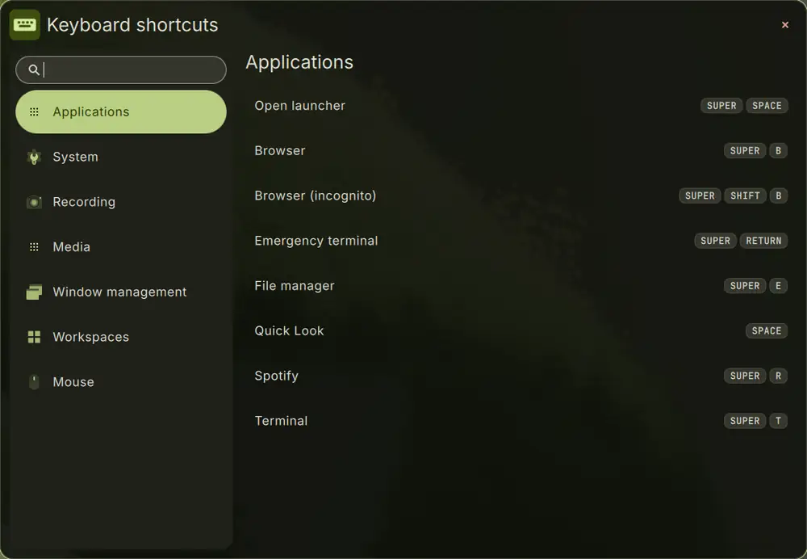

# Keyboard shortcuts

Almost everything in ModernOS can be done from the keyboard. This chapter lists every shortcut that works out of the box. The groups match the keyboard shortcut sheet you can open at any time with `SUPER + K`.

SUPER is the key with the Windows or logo symbol, usually between Ctrl and Alt. A `+` means "hold these keys together". `SUPER + SHIFT + B`, for example, means: hold SUPER and Shift, then press B.

Each name is given in English with the German label in parentheses. You can switch the desktop language in System Settings under Language & Time (Sprache & Zeit).

## Applications (Anwendungen)

| Keys | What it does |
|---|---|
| `SUPER + SPACE` | Open launcher (Launcher öffnen) |
| `SUPER + T` | Terminal |
| `SUPER + RETURN` | Emergency terminal (Notfall-Terminal) |
| `SUPER + B` | Browser |
| `SUPER + SHIFT + B` | Browser (incognito) (Browser (Inkognito)) |
| `SUPER + E` | File manager (Dateimanager) |
| `SUPER + R` | Spotify |
| `SPACE` | Quick Look (Schnellansicht) |

- `SUPER + T`, `SUPER + B` and `SUPER + E` open the apps you picked as defaults in Settings → Applications (Anwendungen).
- `SUPER + RETURN` always opens the kitty terminal, even if your default terminal is set to something else. It's a safety net for when something else is broken.
- `SPACE` opens Quick Look for the selected file in the file manager. In every other app, Space works as usual. See [The desktop](03-desktop.md).

## System

| Keys | What it does |
|---|---|
| `SUPER + I` | Open settings (Einstellungen öffnen) |
| `SUPER + N` | Control panel (Kontrollzentrum) |
| `SUPER + A` | Assistant chat (Assistent-Chat) |
| `SUPER + TAB` | Overview (Übersicht) |
| `SUPER + DELETE` | Applications (Anwendungen), the list of running apps |
| `SUPER + W` | Wallpaper picker (Hintergrund wählen) |
| `SUPER + K` | Keyboard shortcuts (Tastenkombinationen) |
| `SUPER + Y` | Open the ModernOS manual |
| `SUPER + SHIFT + C` | Color picker (Farbwähler) |
| `SUPER + #` | Report a problem (Problem melden) |
| `SUPER + L` | Lock screen (Sperrbildschirm) |
| `SUPER + M` | Power menu (Ein/Aus-Menü) |
| `SUPER + SHIFT + M` | Exit Hyprland (Hyprland beenden) |

- The color picker turns the mouse pointer into a crosshair. Click anywhere on the screen, and that color is copied to the clipboard.
- `SUPER + SHIFT + M` ends your session at once, without asking. Use the power menu (`SUPER + M`) if you'd like a choice.
- For `SUPER + #`, see "Keyboard layouts" below.

## Recording (Aufnahme)

| Keys | What it does |
|---|---|
| `PRINT` | Screenshot region (Bereich aufnehmen) |
| `SHIFT + PRINT` | Screenshot window (Fenster aufnehmen) |
| `SUPER + PRINT` | Screenshot full screen (Ganzen Bildschirm aufnehmen) |

PRINT is the key labelled Print, PrtSc or Druck. The screenshot tools can also record the screen. See [The desktop](03-desktop.md).

## Media (Medien)

These are the special keys many keyboards and laptops have, often on the F-key row. They work even while the screen is locked.

| Key | What it does |
|---|---|
| Volume up key | Volume up (Lauter) |
| Volume down key | Volume down (Leiser) |
| Mute key | Mute (Stumm) |
| Microphone key | Mute microphone (Mikrofon stumm) |
| Play key | Play or pause (Wiedergabe) |
| Pause key | Pause |
| Next key | Next track (Nächster Titel) |
| Previous key | Previous track (Vorheriger Titel) |
| Brightness up key | Brighter (Heller) |
| Brightness down key | Dimmer (Dunkler) |

The play, next and previous keys control whatever is currently playing, such as Spotify, a video in the browser, or the Mediaplayer.

## Window management (Fensterverwaltung)

| Keys | What it does |
|---|---|
| `SUPER + Q` | Close window (Fenster schließen) |
| `SUPER + F` | Fullscreen (Vollbild) |
| `SUPER + V` | Toggle floating (Schwebend umschalten) |
| `SUPER + P` | Pseudo tile (Pseudo-Kachel) |
| `SUPER + J` | Toggle split (Teilung umschalten) |
| `SUPER + LEFT` | Focus left (Fokus links) |
| `SUPER + RIGHT` | Focus right (Fokus rechts) |
| `SUPER + UP` | Focus up (Fokus oben) |
| `SUPER + DOWN` | Focus down (Fokus unten) |
| `SUPER + SHIFT + LEFT` | Move window left (Fenster nach links) |
| `SUPER + SHIFT + RIGHT` | Move window right (Fenster nach rechts) |
| `SUPER + SHIFT + UP` | Move window up (Fenster nach oben) |
| `SUPER + SHIFT + DOWN` | Move window down (Fenster nach unten) |

What each of these does is explained in [Windows and workspaces](05-windows-and-workspaces.md).

## Workspaces (Arbeitsbereiche)

| Keys | What it does |
|---|---|
| `SUPER + 1` … `SUPER + 9` | Workspace 1 to 9 (Arbeitsbereich 1 to 9) |
| `SUPER + 0` | Workspace 10 (Arbeitsbereich 10) |
| `SUPER + SHIFT + 1` … `SUPER + SHIFT + 9` | Move to workspace 1 to 9 (Auf Arbeitsbereich 1 to 9) |
| `SUPER + SHIFT + 0` | Move to workspace 10 (Auf Arbeitsbereich 10) |

Use the number keys in the row above the letters, not the number pad.

## Mouse (Maus)

| Mouse | What it does |
|---|---|
| `SUPER` + left button, drag | Move window (Fenster verschieben) |
| `SUPER` + right button, drag | Resize window (Fenstergröße ändern) |
| Drag a window border | Resize window from edge (Fenster am Rand skalieren) |
| Middle button on an entry in Applications | Close in Applications (In Anwendungen schließen) |
| Hold MB4, move the mouse | Move window (side button) |
| Hold MB5, move the mouse | Resize window (side button) |
| MB4 + MB5 | Close window (side button) |
| Hold MB4, click the middle button | Toggle floating (side button) |
| Hold MB5, click the middle button | Toggle fullscreen (side button) |

MB4 is the rear mouse side button, MB5 the front one. The side-button controls only work while Mouse control (Maussteuerung) is turned on in System Settings under Keyboard (Tastatur). The shortcut sheet only lists them while that setting is on. A quick click on a side button still works as back or forward. More on this in [Windows and workspaces](05-windows-and-workspaces.md).

## Shortcuts in games and full-screen apps

Some games and apps capture the keyboard for themselves. Even then, the following keep working:

- the shortcuts that open the launcher, Assistant, Applications, control panel, power menu, shortcut sheet, Overview, wallpaper picker, Settings and Report a problem
- `SUPER + F` (fullscreen) and `SUPER + Q` (close)

That way you can always get out of a game that has taken over the screen.

## Keyboard layouts

A few shortcuts are tied to the position of a key on the keyboard, not to the letter printed on it, so they stay in the same place when you switch layouts:

- the number row (`SUPER + 1` to `SUPER + 0`, with or without Shift)
- `SUPER + A` (Assistant chat)
- `SUPER + DELETE` (Applications)
- `SUPER + #` (Report a problem)

On a German keyboard, `#` is the key directly left of Enter, next to Ä. On a US keyboard, the same key is labelled backslash (`\`), so there the shortcut is `SUPER + \`. Other layouts have their own symbol on that key, but the position stays the same.

You can choose your keyboard layout in System Settings → Keyboard (Tastatur).

## Changing shortcuts

The Keyboard page in System Settings shows your shortcuts (See keyboard shortcuts (Tastenkombinationen anzeigen)), but it doesn't edit them. To give an action a different key, you edit your settings file directly. Only do this if you are comfortable with a text editor.

1. Open the file `~/.config/modern/config.json` in a text editor. `~` stands for your home folder, and `.config` is a hidden folder.
2. Find the `"keybinds"` section. Each line pairs an action with its keys, for example `"terminal": "SUPER + T"`.
3. Change the keys between the quotes. Write them in capitals and put ` + ` between them, for example `"SUPER + SHIFT + T"`. Keep every quote and comma as it is.
4. Save the file.
5. Apply the change: open a terminal (`SUPER + T`), type `hyprctl reload` and press Enter. Signing out and back in works too.

The shortcut sheet (`SUPER + K`) picks up your new keys by itself.

A few things to know:

- If you change one of the shortcuts tied to a key position (see "Keyboard layouts" above), your new shortcut uses the printed letter or symbol instead.
- `SUPER + RETURN` (emergency terminal), the media keys and the mouse controls are fixed. They can't be changed in this file.
- Make sure two actions don't share the same keys.

### Going back to the original shortcuts

If something stops working, open System Settings → Keyboard (Tastatur) and press Restore (Zurücksetzen) at the top of the page. After you confirm, every shortcut goes back to its original key. The keyboard options on that page reset as well: the layout, key repeat, Num Lock and Mouse control. The change takes effect right away.

## See also

- [Launcher and Overview](04-launcher-and-overview.md) for the keys that work inside the launcher, the Overview and Applications
- [Settings](07-settings.md) for the Keyboard page
- [Troubleshooting](14-troubleshooting.md) if a shortcut does nothing
- [Keybind reference](../KEYBINDS.md) for the technical details
