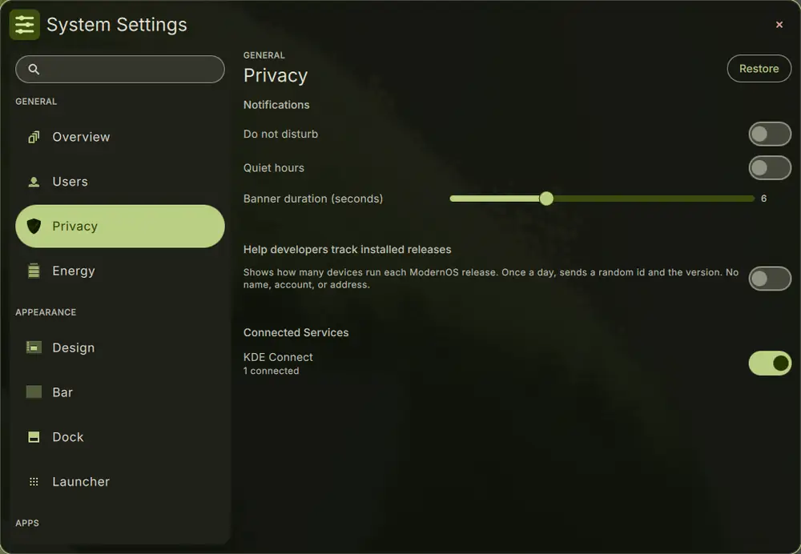
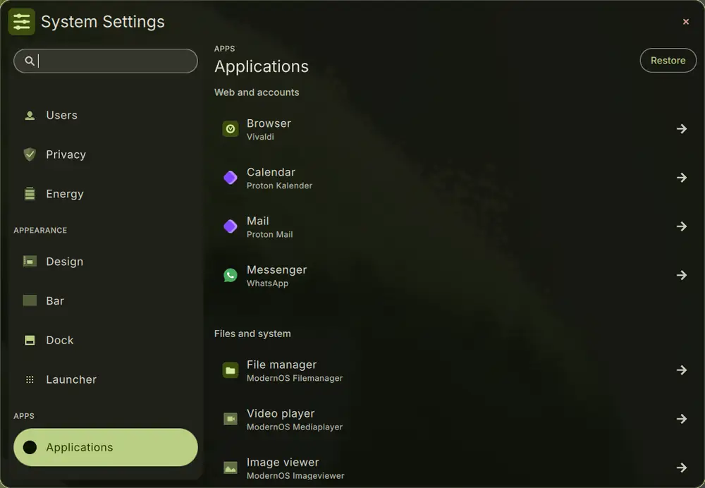
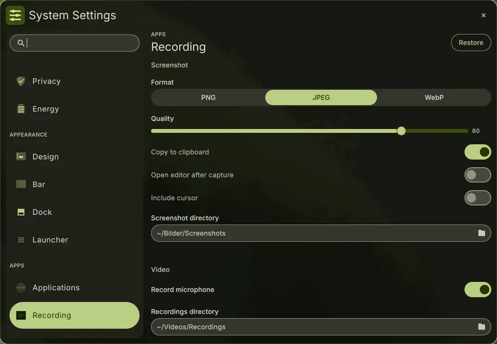
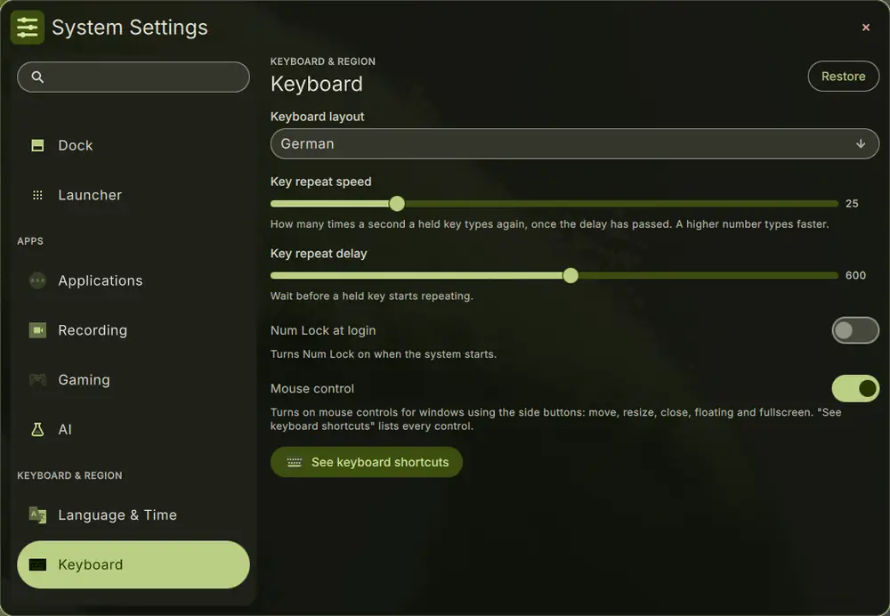

# Settings

The Settings app is where you change how ModernOS looks and behaves. Open it with **SUPER + I**, from the launcher (search for "Settings"), from the Settings icon in the dock, or from the gear in the Assistant panel. The window is called **System Settings** (Systemeinstellungen).

This chapter walks through every page in the order you see them. Labels are given in English with the German label in parentheses the first time they appear. You can switch the language at any time under **Language & Time** (Sprache & Zeit).

## How your settings are stored

Everything you change in Settings is saved in one file: `~/.config/modern/config.json`. The desktop watches this file, so most changes take effect immediately. You do not need to log out or restart.

- Settings only ever writes this one file. It never rewrites anything else on your system.
- If a value is missing from the file, ModernOS uses its built-in default.
- Many pages have a **Restore** (Zurücksetzen) button in the top right. It asks "Restore … settings?" and then resets every option on that page to the shipped defaults. Other pages are not affected.
- Passwords and API keys are **not** stored in this file. They live in a separate private file (see [AI assistant](10-assistant.md)).

## Finding your way around

The left side of the window is the navigation. Pages are grouped:

| Group | Pages |
|---|---|
| General (Allgemein) | Overview, Users, Privacy, Energy |
| Appearance (Erscheinungsbild) | Design, Bar, Dock, Launcher |
| Apps (Apps) | Applications, Recording, Gaming, AI |
| Keyboard & Region (Tastatur & Region) | Language & Time, Keyboard |
| Devices (Geräte) | Display, Audio, Network, Bluetooth |
| System (System) | Storage, Backup, Firewall, Update |

At the top of the navigation is a search field, **Search settings...** (Einstellungen durchsuchen...). It matches page names and related words, so typing "wifi", "mouse" or "snapshot" finds the right page.

- **Enter** opens the first match. **Esc** clears the search.
- **Up** and **Down** move through the list, **Home** and **End** jump to the first or last page, and **Right** moves into the page itself.
- The **Update** entry shows a small number badge when updates are waiting.

### Pages for administrators

**Backup**, **Firewall** and **Update** are only shown to administrator accounts. If your account is not an administrator, these pages are hidden from the list and from search. Some actions on other pages, such as adding users or cleaning up storage, also ask for an administrator password.

## General

### Overview (Übersicht)

A summary of your computer.

- **Software**: the system, kernel, session, window manager, shell, and which apps are set as your launcher, file manager, video player, image viewer, text editor, browser and terminal.
- **Hardware**: processor, graphics card, memory, motherboard and storage.
- **Boot time** (Startzeit): how long the last start took, split into firmware, boot loader, early start and the rest of the system.
- **Live stats** (Live-Werte): current processor, graphics, memory and disk usage plus temperature.

The **Support ModernOS** (ModernOS unterstützen) button at the top opens the project's donation page in your browser.

### Users (Benutzer)

Manage the people who use this computer.

- The card at the top is your own account. Hover over the picture and choose **Change picture** (Bild ändern) to pick an image. Drag to position it; the circle shows what will be saved. You can also rotate and resize it.
- Tags show **You** (Du) for your account and **Admin** for administrators.
- The edit button opens **Edit user** (Benutzer bearbeiten). Here you can set the **Display name** (Anzeigename), which appears in the power menu, on the lock screen and on the login screen. **Change password** (Passwort ändern) opens a terminal where you type the new password. Administrators can also make an account an admin and choose its groups.
- **Auto login** (Automatische Anmeldung): after the next restart, this account goes straight to the desktop without a login prompt. Only administrators can change it.
- **Other people** (Andere Personen) lists the remaining accounts. **Add user** (Benutzer hinzufügen) asks for a username, a display name, a password (twice), whether the person is an administrator, and optional groups.
- **Groups** (Gruppen) lists groups. **Add group** (Gruppe hinzufügen) creates one. Deleting a group does not delete the people in it.

Some safety rules always apply: you cannot delete or rename the account you are signed in with, and at least one administrator must remain. Deleting another account asks first and also removes that person's home folder. Changes here need an administrator password.

### Privacy (Datenschutz)

**Notifications** (Benachrichtigungen)

- **Do not disturb** (Nicht stören): hides notification banners.
- **Quiet hours** (Ruhezeiten): turns on Do not disturb automatically between **From** (Von) and **To** (Bis). The default is 23:00 to 07:00.
- **Banner duration (seconds)** (Banner-Dauer (Sekunden)): how long a banner stays on screen, from 2 to 15 seconds. The default is 6.

**Connected Services** (Verbundene Dienste)

- **KDE Connect**: lets your phone talk to this computer. The line below shows how many devices are connected.

Restore on this page also turns Do not disturb off.

### Energy (Energie)

On a laptop, a battery section shows the remaining time (or time until full), the current power draw, battery health, charge level, charge cycles and voltage.

**Idle** (Leerlauf)

| Option | What it does | Default |
|---|---|---|
| Inhibit idle on fullscreen (Idle bei Vollbild unterdrücken) | Never dims or locks while a window is fullscreen | On |
| Inhibit idle while media plays (Idle bei Wiedergabe unterdrücken) | Never dims or locks while audio or video plays | On |
| Dim after (Abdunkeln nach) | Dims the screen when you are away | 2 min |
| Screen off (Bildschirm aus) | Turns the screen off | 5 min |
| Lock (Sperren) | Locks the session | 10 min |
| Sleep (Schlafmodus) | Puts the computer to sleep | 30 min |

Each timer can be set to Never or to a time between 2 minutes and 12 hours.

**Power** (Ein/Aus)

- **Power button** (Ein/Aus-Taste): what happens when you press the power button. Choose **Power menu** (Power-Menü, the default), **Sleep** (Schlafmodus), **Lock** (Sperren) or **Shut down** (Herunterfahren).
- On laptops you also get **Lid close (on AC)** (Deckel schließen (Netzteil)), default Lock, and **Lid close (on battery)** (Deckel schließen (Akku)), default Sleep.

## Appearance

### Design (Design)

This page controls wallpaper, colors, fonts and windows. Colors and wallpapers are explained in detail in [Appearance](08-appearance.md).

**Wallpaper** (Hintergrundbild)

- The large tile is your current wallpaper. Next to it are random suggestions from your library. Click one to apply it.
- **Browse wallpapers** (Hintergründe durchsuchen) opens the full wallpaper picker.
- **Color brightness** (Farbhelligkeit): lightens surfaces, buttons and icons with the wallpaper color. Higher is brighter.
- **Wallpaper animation** (Hintergrund-Animation): how the new wallpaper appears. Choose Fade (Überblenden), Grow (Wachsen), Wipe (Wischen), Wave (Welle), Outer (Nach innen), Grow (random) (Wachsen (zufällig)), Instant fade (Sofort) or Random (Zufällig). Picking one plays it once as a preview.
- **Wallpaper Provider** (Hintergrund-Anbieter): the website the picker opens when you click "Get wallpapers".

**System colors** (Systemfarben)

- **Light and dark** (Hell und dunkel): **Dark** (Dunkel) or **Light** (Hell).
- **Color variant** (Farbvariante): a row of cards generated from your current wallpaper. Each shows three sample colors. Click a card to use it.

**Font size** (Schriftgröße): makes all text in the desktop larger or smaller.

**Animations** (Animationen): how long menus, the bar and windows take to move. **Off** (Aus) is instant, **Default** (Standard) is normal and **Slow** (Langsam) is calmer.

**Cursor**

- **Cursor theme** (Cursor-Thema): choose from the cursor themes installed on your computer.
- **Cursor size** (Cursor-Größe): from 16 to 48. The default is 24.

**Windows** (Fenster)

- **Transparency** (Transparenz): how see-through panels and menus are. It is greyed out while **Drop effects for speed** is on (see Gaming below).
- **Corner rounding** (Eckenrundung): rounder or squarer corners everywhere.
- **Window gaps** (Fensterabstände): **Inner gaps** (Innere Abstände) between windows and **Outer gaps** (Äußere Abstände) between windows and the screen edge.
- **Window opacity** (Fensterdeckkraft): how solid app windows are. 100 percent is fully solid.
- **Window rules** (Fensterregeln): an advanced text box for special per-app window rules. Press **Save** (Speichern) to apply or **Cancel** (Abbrechen) to discard. The text is checked before it is saved, so a typo does not break anything.

### Bar (Leiste)

- **Bar position** (Leistenposition): **Top** (Oben), **Bottom** (Unten), **Left** (Links) or **Right** (Rechts).
- **Height** (Höhe), **Font size** (the same setting as on Design), **Top and bottom padding** (Abstand oben und unten) and **Left and right padding** (Abstand links und rechts).
- **Auto-hide bar** (Leiste automatisch ausblenden): the bar slides away and comes back when you move the pointer to that screen edge. It stays visible while one of its menus is open.

**Widgets Position** (Widget-Position) shows the three parts of the bar: **Left island** (Linke Insel), **Middle island** (Mittlere Insel) and **Right island** (Rechte Insel). Drag widgets to move or reorder them.

**Available widgets** (Verfügbare Widgets) lists every widget with a switch. A widget you turn on is added to the left island; drag it where you want it.

| Widget | Shows |
|---|---|
| Applications (Anwendungen) | Opens the launcher |
| Assistant (Assistent) | Opens the AI chat |
| Workspaces (Arbeitsbereiche) | Your workspaces |
| Media (Medien) | What is playing |
| Applications (taskbar) | Your open windows |
| Date and time (Datum und Uhrzeit) | The clock and calendar |
| Weather (Wetter) | Current weather |
| Network and Bluetooth (Netzwerk und Bluetooth) | Connection status |
| Volume (Lautstärke) | Sound level |
| Battery (Akku) | Battery charge |
| Control panel (Kontrollzentrum) | Quick toggles |
| Power (Ein/Aus) | The power menu |

Some widgets have their own options and show a small edit mark. Click the widget to open its options:

- **Weather**: Celsius or Fahrenheit, and **Use current location** (Aktuellen Standort verwenden). Turn that off to search for a **City** (Stadt) instead.
- **Date and time**: **Show weekday** (Wochentag anzeigen), **Show seconds** (Sekunden anzeigen), and connecting a calendar. You can connect Proton Calendar, Google Calendar (Google Kalender) or Apple Calendar (Apple Kalender) with a private calendar link, or Apple Calendar with your Apple ID and an app-specific password. These details are stored in the private secrets file, not in your settings.
- **Volume** and **Media**: **Scroll step** (Scrollschritt) sets how much the mouse wheel changes the level. **Fine scroll step** (Feiner Scrollschritt) is used while you hold Shift.

### Dock (Dock)

The dock is on when you first sign in. **Show dock** (Dock anzeigen) turns it off. It sits on the screen edge opposite the bar.

- **Auto-hide** (Automatisch ausblenden): the dock hides until you move to its edge.
- **Show names** (Namen anzeigen): shows app names under the icons.
- **Style** (Stil): **Floating** (Schwebend), **Edge dash** (Kantenstrich) or **Plate** (Platte).
- **Hover animation** (Hover-Animation): Zoom, Color (Farbwechsel), Bounce (Federn), Lift (Anheben) or None (Keine).
- **Icon size** (Symbolgröße), **Top and bottom padding** and **Spacing between applications** (Abstand zwischen Anwendungen).

**Applications in the dock** (Anwendungen im Dock) shows your pinned apps. Drag apps from **Installed applications** (Installierte Anwendungen) into the row to pin them, and drag inside the row to reorder. To unpin, drag an icon off the dock onto the trash that appears, **Remove from dock** (Vom Dock entfernen).

Restore on this page resets the look of the dock but keeps your pinned apps and the on/off switch.

### Launcher (Launcher)

- **Frecency ranking** (Häufigkeitsranking): sorts results by how often and how recently you opened them.
- **Show icons** (Symbole anzeigen) and **Show descriptions** (Beschreibungen anzeigen).
- **Result count** (Anzahl Ergebnisse): how many search results are shown, from 4 to 20.
- **Most used** (Häufig verwendet): how many favourite apps appear before you type, from 4 to 16.

## Apps

### Applications (Anwendungen)

Choose which app is used for each job.

**Web and accounts** (Web und Konten): **Browser**, **Calendar** (Kalender), **Mail** and **Messenger**. Calendar, Mail and Messenger can also be left empty. When you choose one, it is added to autostart and started in the background so you get notifications.

**Files and system** (Dateien und System): **File manager** (Dateimanager), **Video player** (Videoplayer), **Image viewer** (Bildbetrachter), **Text editor** (Texteditor) and **Terminal**. Changing these also changes which app opens your files when you double-click them.

**Autostart** lists apps that start when you log in. Remove one with its button, or add one with **Add autostart app** (Autostart-App hinzufügen). Mail, calendar and messenger apps start hidden so they can notify you. The very first time you link WhatsApp, open it once from the launcher so you can scan the code.

The apps themselves are described in [Apps](09-apps.md).

### Recording (Aufnahme)

**Screenshot** (Bildschirmfoto)

- **Format**: PNG, JPEG or WebP. **Quality** (Qualität) applies to JPEG and WebP only.
- **Copy to clipboard** (In Zwischenablage kopieren): on by default.
- **Open editor after capture** (Editor nach Aufnahme öffnen): opens each new screenshot in an editor so you can mark it up before using it.
- **Include cursor** (Cursor einschließen): shows the mouse pointer in the picture.
- **Screenshot directory** (Screenshot-Ordner): where pictures go. The default is `~/Pictures/Screenshots`.

**Video**

- **Record microphone** (Mikrofon aufnehmen): on by default.
- **Recordings directory** (Aufnahmeordner): the default is `~/Videos/Recordings`.

Take screenshots and recordings with the keyboard: **Print** for an area, **Shift + Print** for a window, and **SUPER + Print** for the whole screen. See [Keyboard shortcuts](06-keyboard-shortcuts.md).

### Gaming (Spiele)

At the top you see tiles for **Last played** (Zuletzt gespielt), **Hours played** (Spielzeit), **Installed** (Installiert), **Library** (Bibliothek, in GB) and **Open now** (Gerade offen), plus **Now playing** (Läuft gerade) while a game runs.

**Play** (Spielen)

- **Gaming mode** (Spielmodus): keeps the computer awake and gives the game window special treatment while you play.
- **Fullscreen games automatically** (Spiele automatisch im Vollbild): on by default.
- **HDR for games** (HDR für Spiele): needs an HDR screen with HDR turned on under **Display** first.

**Performance** (Leistung)

- **Drop effects for speed** (Effekte für Tempo weglassen): for slower computers. It turns off blur, shadows and wobble, makes panels solid, lets games draw directly to the screen, and makes the browser lighter after its next restart.

More in [Gaming](11-gaming.md).

### AI (KI)

Choose and set up the AI assistant. This page is explained step by step in [AI assistant](10-assistant.md).

## Keyboard & Region

### Language & Time (Sprache & Zeit)

A live preview of the date and time is shown at the top.

- **UI language** (UI-Sprache): English or German. The desktop switches right away.
- **First day of week** (Erster Wochentag): Monday or Sunday.
- **Date format** (Datumsformat): DD.MM.YYYY, YYYY-MM-DD or MM/DD/YYYY.
- **Time format** (Zeitformat): 24-hour (HH:mm) or 12-hour (hh:mm a).

### Keyboard (Tastatur)

- **Keyboard layout** (Tastaturlayout): pick your layout from a searchable list.
- **Key repeat speed** (Tastenwiederholung) and **Key repeat delay** (Wiederholverzögerung): how fast a held key repeats, and how long before it starts.
- **Num Lock at login** (Num-Lock bei der Anmeldung): turns Num Lock on when you sign in.
- **Mouse control** (Maussteuerung): lets the side buttons of your mouse control windows.
- **See keyboard shortcuts** (Tastenkombinationen anzeigen): opens the shortcut overview, which you can also open with **SUPER + K**.

Shortcuts can be viewed here but not changed. The full list is in [Keyboard shortcuts](06-keyboard-shortcuts.md).

## Devices

### Display (Anzeige)

- **Workspace arrangement** (Workspace-Anordnung): **Dynamic** (Dynamisch) opens a workspace on whichever screen your pointer is on. **Fixed** (Fixiert) gives each screen its own numbers: workspaces 1 to 5 on the first screen from the left, 6 to 10 on the next, and so on.
- **Monitor profiles** (Monitorprofile): one card per screen. Drag the cards to match how your screens stand on your desk, or use **Ctrl + Left/Right**. Click a card to change that screen.

For the selected screen:

- **Default display** (Standardanzeige): the screen that has focus when the desktop starts.
- **HDR** and **Variable refresh** (Variable Bildwiederholung): only shown if the screen supports them.
- **Brightness** (Helligkeit): only shown if the screen allows it.
- **Resolution** (Auflösung) and **Refresh rate** (Bildwiederholrate).
- **Scale** (Skalierung): 100, 110, 125, 150 or 200 percent. Larger makes everything bigger.
- **Color profile** (Farbprofil): sRGB, Wide (if supported) or Native (EDID) (Nativ (EDID)). Hidden while HDR is on.

### Audio (Audio)

- **Master volume limit** (Lautstärkegrenze): the highest volume allowed, up to 150 percent.
- **Speaker** (Lautsprecher) and **Microphone** (Mikrofon): choose the device and set its level.
- **Set default** (Standard festlegen): the device sound goes back to when Bluetooth headphones disconnect.
- **Connect Bluetooth headphones** (Bluetooth-Kopfhörer verbinden): sound moves to your headphones when they connect and back when they disconnect.
- **Applications** (Anwendungen): a volume slider and **Mute** (Stumm) button for every app that is playing sound.

### Network (Netzwerk)

- **Wi-Fi** (WLAN): turn wireless on or off. **Ethernet** shows whether a cable is connected and its address.
- **Nearby networks** (Netzwerke in der Nähe): click a network to **Connect** (Verbinden), **Disconnect** (Trennen) or **Forget** (Vergessen). Networks you have used before are marked **Saved** (Gemerkt). If connecting fails, the message tells you why, for example a wrong password or a weak signal. Company networks that need a username login are not supported.
- **Speed test** (Geschwindigkeitstest): downloads for about 15 seconds and shows download speed, data transferred, duration and connection timings.

### Bluetooth (Bluetooth)

- The switch at the top turns Bluetooth on or off. When you open the page, a short search for devices runs.
- **Connected** (Verbunden) and **Available** (Verfügbar) list devices. Use the refresh button to search again.
- Click a device to **Connect**, **Disconnect** or **Forget** it.

Tip: if headphones no longer connect, put them in pairing mode and connect again. Headphones only show as connected once their sound is ready.

## System

### Storage (Speicher)

- **System disk** (Systemplatte): how full your main drive is. **Calculate categories** (Kategorien berechnen) breaks it down into games, files, programs, AI models, cache, snapshots, other and free space.
- **Clean up** (Aufräumen), at the top of the page, removes old package downloads, logs older than 14 days and caches that can be rebuilt. It never touches your documents, photos, downloads or games. It asks for an administrator password.
- **Other drives** (Weitere Laufwerke) and **External** (Extern) list other disks and USB drives with **Open** (Öffnen) and **Eject** (Auswerfen) buttons.

### Backup (Sicherung)

For administrators only. ModernOS can take snapshots of the system so you can go back to an earlier state.

- If snapshots are not set up yet, **Create config** (Config anlegen) sets them up.
- **Snapshot before updates** (Snapshot vor Updates): takes a snapshot automatically before every update.
- **Remove old snapshots** (Alte Snapshots entfernen) with **Keep at most** (Höchstens behalten): deletes the oldest snapshots so only that many remain.
- **Snapshots** lists every snapshot. **Create snapshot** (Snapshot erstellen) makes one now, **Clear all** (Alle löschen) removes all, and each entry has **Restore** (Wiederherstellen) and **Delete** (Löschen).

Restoring a snapshot restarts the computer. Your personal files in your home folder are not changed. More in [Updates and backups](12-updates-and-backups.md).

### Firewall (Firewall)

For administrators only.

- **Enable firewall** (Firewall einschalten): blocks incoming connections and allows outgoing ones. Turning it off asks for confirmation.
- **Allow rules** (Allow-Regeln) and **Deny rules** (Deny-Regeln): add exceptions. Each rule has a **Port** (for example 22, or a range like 1714:1764), a **Protocol** (Protokoll: Any, TCP or UDP), a **Direction** (Richtung: In or Out), an optional **From** (Von) address (empty means anywhere), and a **Comment** (Kommentar). You can edit a rule's comment or delete the rule.

More in [Privacy and security](13-privacy-and-security.md).

### Update (Aktualisierung)

For administrators only.

- The status card says whether your system is up to date, how many updates are waiting, or that a new ModernOS version is available. **Search for Updates** (Nach Updates suchen) checks again.
- **Update system** (System aktualisieren) installs everything. If **Snapshot before updates** is on, a snapshot is taken first.
- **Update mirrors** (Mirrors aktualisieren) picks fast download servers. This also happens automatically twice a month.
- **Package Update** (Paketupdate) lists what will change, split into **System packages** (Systempakete) and **Other packages** (Andere Pakete), with old and new versions. **Changelog** (Änderungen) shows what is new.

More in [Updates and backups](12-updates-and-backups.md).
