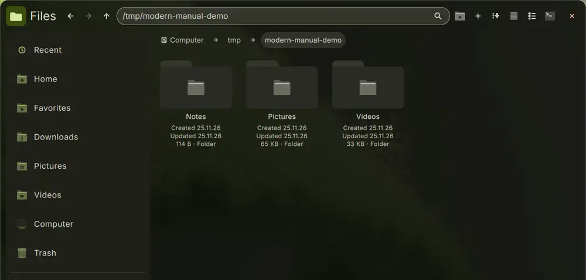
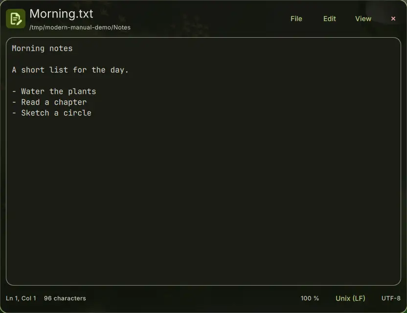
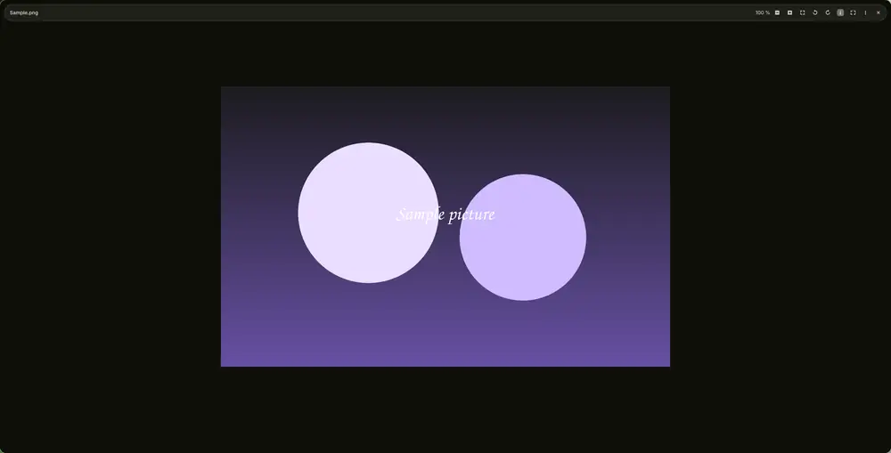
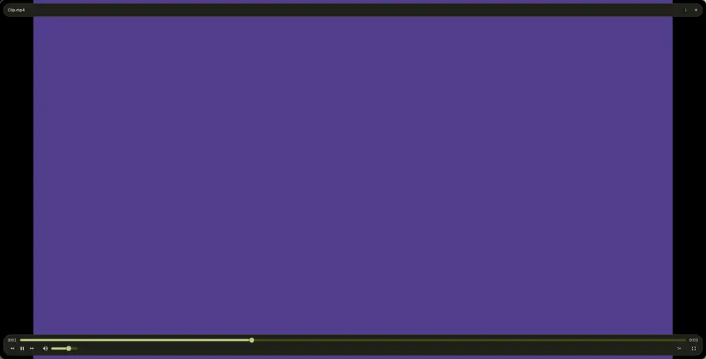
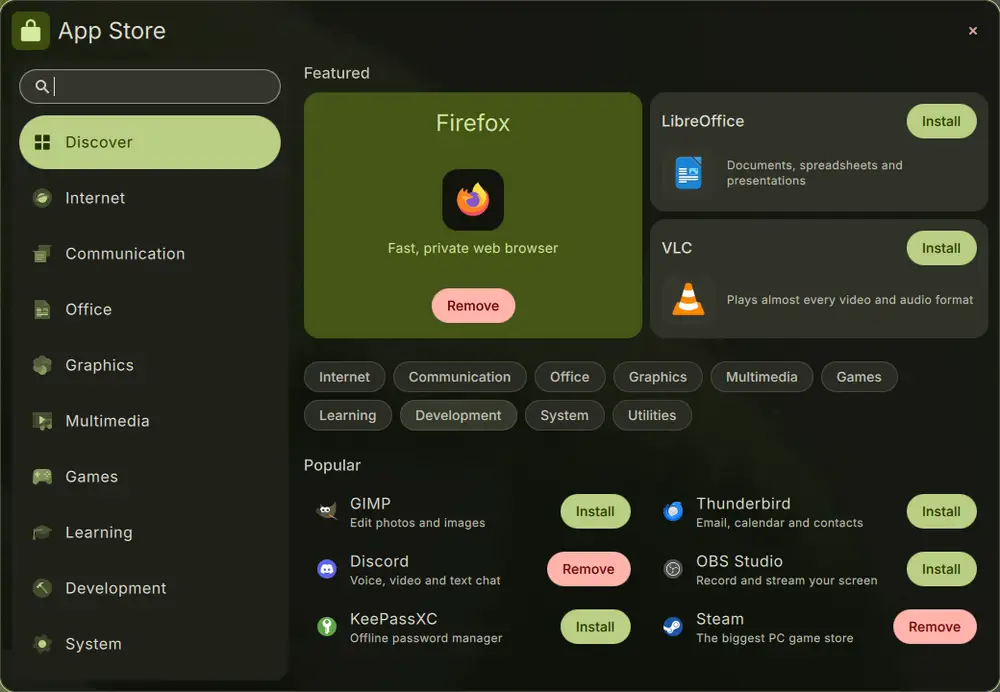
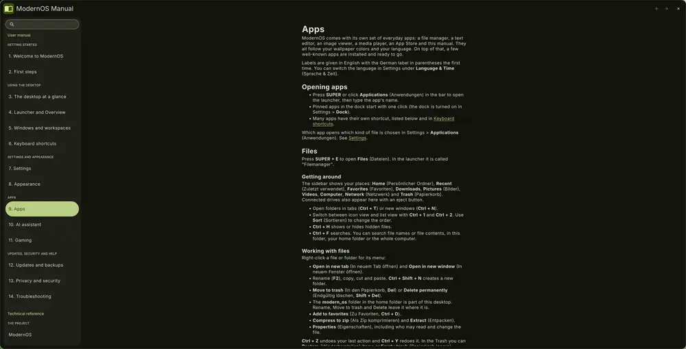
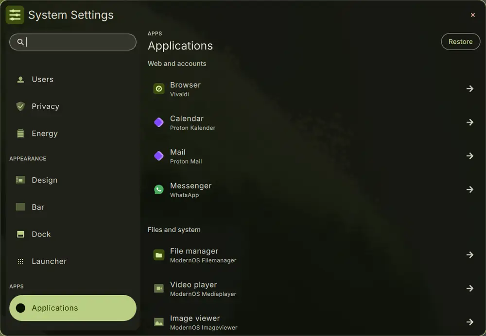

# Apps

ModernOS comes with its own set of everyday apps: a file manager, a text editor, an image viewer, a media player, an App Store and this manual. They all follow your wallpaper colors and your language. On top of that, a few well-known apps are installed and ready to go.

Labels are given in English with the German label in parentheses the first time. You can switch the language in Settings under **Language & Time** (Sprache & Zeit).

## Opening apps

- Press **SUPER** or click **Applications** (Anwendungen) in the bar to open the launcher, then type the app's name.
- Pinned apps in the dock start with one click (the dock is turned on in Settings > **Dock**).
- Many apps have their own shortcut, listed below and in [Keyboard shortcuts](06-keyboard-shortcuts.md).

Which app opens which kind of file is chosen in Settings > **Applications** (Anwendungen). See [Settings](07-settings.md).

## Files

Press **SUPER + E** to open **Files** (Dateien). In the launcher it is called "Filemanager".

### Getting around

The sidebar shows your places: **Home** (Persönlicher Ordner), **Recent** (Zuletzt verwendet), **Favorites** (Favoriten), **Downloads**, **Pictures** (Bilder), **Videos**, **Computer**, **Network** (Netzwerk) and **Trash** (Papierkorb). Connected drives also appear here with an eject button.

- Open folders in tabs (**Ctrl + T**) or new windows (**Ctrl + N**).
- Switch between icon view and list view with **Ctrl + 1** and **Ctrl + 2**. Use **Sort** (Sortieren) to change the order.
- **Ctrl + H** shows or hides hidden files.
- **Ctrl + F** searches. You can search file names or file contents, in this folder, your home folder or the whole computer.

### Working with files

Right-click a file or folder for its menu:

- **Open in new tab** (In neuem Tab öffnen) and **Open in new window** (In neuem Fenster öffnen).
- Rename (**F2**), copy, cut and paste. **Ctrl + Shift + N** creates a new folder.
- **Move to trash** (In den Papierkorb, **Del**) or **Delete permanently** (Endgültig löschen, **Shift + Del**).
- The **modern_os** folder in the home folder is part of this desktop. Rename, Move to trash and Delete leave it where it is.
- **Add to favorites** (Zu Favoriten, **Ctrl + D**).
- **Compress to zip** (Als Zip komprimieren) and **Extract** (Entpacken).
- **Properties** (Eigenschaften), including who may read and change the file.

**Ctrl + Z** undoes your last action and **Ctrl + Y** redoes it. In the Trash you can **Restore** (Wiederherstellen) items or **Empty trash** (Papierkorb leeren).

If you paste a file where one with the same name already exists, you can overwrite it (the old file goes to the trash) or keep both under a new name.

### Handy extras

- Press **Space** on a file for **Quick Look** (Schnellansicht), a fast preview. **Enter** opens it in its usual app.
- **Open terminal here** (Terminal hier öffnen) starts a terminal in the current folder.
- **Ctrl + C** in the location bar copies the folder's path exactly as shown. Pasting it into the terminal adds a backslash before spaces, so `cd` gets the whole path.
- **Connect to server** (Mit Server verbinden) opens a network share.

### Choosing files for other apps

When an app such as Vivaldi asks you to pick a file, for example to upload a picture, a Files window opens titled **Choose files** (Dateien auswählen). Everything you know from Files works there: places, search, tabs and Quick Look.

- Select one file, or several with **Ctrl** or **Shift** when the app accepts more, and click **Use these files** (Diese Dateien verwenden) or press **Enter**.
- If the app only accepts certain types, the menu next to the location shows them, for example **Images** (Bilder). Pick another entry to allow other files.
- When an app saves a file, the window is titled **Save as** (Speichern unter). Go to a folder, type the name and click **Save** (Speichern). If a file with that name is already there, Files asks before replacing it.
- Close the window to cancel. The app then gets nothing.

## Texteditor

A simple, fast editor for notes and plain text files. Open it from the launcher, or open any text file from Files.

- The **File**, **Edit** (Bearbeiten) and **View** (Ansicht) menus hold every command, together with its shortcut.
- **Find…** (Suchen…, **Ctrl + F**), **Replace…** (Ersetzen…, **Ctrl + H**) and **Go to line…** (Gehe zu Zeile…, **Ctrl + G**).
- **F5** inserts the current **Time/Date** (Uhrzeit/Datum).
- In the View menu: word wrap (**Alt + Z**), **Monospace font** (Schrift mit fester Breite), **Status bar** (Statusleiste) and zoom.
- **Save as** lets you choose the **Encoding** (Kodierung) and **Line endings** (Zeilenende).
- If you close a file with unsaved changes, the editor asks first. Files you are not allowed to change are saved with **Save as** instead.

## Imageviewer

Open a picture from Files and the Imageviewer shows it, together with every other picture in the same folder.

| Keys | What they do |
|---|---|
| **→** or **Space** / **←** or **Backspace** | Next / previous picture |
| **↑** or **+** / **↓** or **-**, mouse wheel | Zoom in / out |
| **R** / **1** | Fit to window / actual size |
| Double-click | Switch between fit and 100 percent |
| **]** / **[** | Turn right / left |
| **Ctrl + S** | Save the turn into the file |
| **F** or **F11** / **Esc** | Fullscreen / leave fullscreen |
| **T** | Slideshow |
| **D** | **Picture details** (Bilddetails) |
| **Ctrl + C** / **Ctrl + Shift + C** | **Copy picture** (Bild kopieren) / copy its path |
| **Del** | Move to trash (asks first) |
| **Ctrl + E** | Show the picture in Files |

Turning a picture only changes the view until you press **Ctrl + S**. The controls fade out after a few seconds without mouse movement.

## Mediaplayer

The Mediaplayer plays both videos and music. When you open a file, the other files in the same folder become the playlist.

| Keys | What they do |
|---|---|
| **Space** or click | Play / pause |
| **→** / **←** | Forward / back 5 seconds |
| **↑** / **↓** | Forward / back 60 seconds |
| **]** / **[** / **Backspace** | Faster / slower / normal **Speed** (Geschwindigkeit) |
| **M** | Mute |
| **J** | Next **Subtitles** (Untertitel) |
| **#** | Next **Audio track** (Tonspur) |
| **N** / **Shift + N** | Next / previous file |
| **S** | Save the current frame to Pictures/Screenshots |
| **F**, **F11** or double-click / **Esc** | Fullscreen / leave fullscreen |
| **Ctrl** + mouse wheel | Zoom into the picture |

- Hover over the timeline to see a preview of that moment.
- **Repeat** (Wiederholen) is on by default.
- The very first time you start the player, it starts muted, so nothing blares out unexpectedly.

## App Store

The **App Store** is where you add and remove programs. Open it from the launcher, from the dock, or from the control panel.

- Browse **Discover** (Entdecken), **Popular** (Beliebt) and categories such as **Internet**, **Office** (Büro), **Graphics** (Grafik), **Multimedia**, **Games** (Spiele), **Communication** (Kommunikation), **Learning** (Lernen), **Development** (Entwicklung), **System** and **Utilities** (Werkzeuge).
- **Installed** (Installiert) shows the programs you have installed.
- Use the search field to look for an app by name or by what it does, for example "photo editing".
- Click an app to see **About** (Über), **Images** (Bilder), **Version**, **Size** (Größe) and **License** (Lizenz).

### Installing and removing

- Click **Install** or **Remove**. The store asks you to confirm and then asks for an administrator password.
- While it works, you can follow the progress and use **Copy log** (Protokoll kopieren) if something goes wrong.
- Programs that ModernOS needs to run cannot be removed.
- The store installs programs from the official Arch Linux software collection.

When the dock is turned on, the details page also has **Add to Dock** (Zum Dock hinzufügen) or **Remove from Dock**.

If updates are waiting, an **Updates available** button takes you to Settings > **Update** (Aktualisierung). See [Updates and backups](12-updates-and-backups.md).

### Uninstalling by dragging to the dock trash

With the dock turned on, you can also remove a program straight from the launcher:

1. Open the launcher.
2. Drag an app from the list toward the dock. A trash target labelled **Uninstall** (Deinstallieren) appears.
3. Drop the app on it. The App Store's remove confirmation opens.

Dropping the app on the dock row instead pins it to the dock. ModernOS's own apps, apps that were not installed from the software collection, and accounts without administrator rights cannot uninstall this way; you then see a short message that the app cannot be uninstalled.

To only take an icon off the dock, drag it from the dock onto **Remove from dock** (Vom Dock entfernen). The program stays installed.

## ModernOS Manual

The manual you are reading is an app too. Open it with **SUPER + Y**, or search for "Manual" in the launcher.

- On the left is a list of every document, in two parts: **User manual** (Benutzerhandbuch), the numbered chapters written for everyday use, and **Technical reference** (Technische Referenz), the documents for people who want to look under the hood. Each part is split into topics, such as **Getting started** (Los geht's) or **Installation and system** (Installation und System).
- The search field, **Search the manual...** (Handbuch durchsuchen...), looks through titles and full text. Press **Ctrl + F** to jump to it, **Enter** to open the first match, and **Esc** to clear it.
- On the right is the open document. You can select and copy text, which is handy for commands in [Troubleshooting](14-troubleshooting.md).
- Links to other documents open inside the manual. **Back** (Zurück), **Alt + Left**, **Backspace** or the back button on the side of your mouse takes you to the previous one. **Forward** (Vorwärts), **Alt + Right** or the mouse's forward button returns.
- Links to websites open in your browser.
- Use the arrow keys, **Page Up**, **Page Down**, **Space**, **Home** and **End** to read. **Left** moves back to the list.
- **Tab** highlights the next link in the document and **Shift + Tab** the previous one; **Enter** opens it. So you can follow links without a mouse.
- **Ctrl + Plus** and **Ctrl + Minus**, or Ctrl with the mouse wheel, make the text larger or smaller. **Ctrl + 0** returns to the normal size.
- Screen readers announce the list, its topic headings and the open document by name.

## Installed apps

ModernOS also includes a few popular apps, already set up:

| App | What it is | Shortcut |
|---|---|---|
| kitty | The terminal. It follows your colors immediately. | **SUPER + T** |
| Vivaldi | The web browser, themed to match the desktop | **SUPER + B**, private window **SUPER + Shift + B** |
| Spotify | Music streaming | **SUPER + R** |
| Steam | Games, see [Gaming](11-gaming.md) | |
| Proton Pass | Password manager | |

If the desktop ever misbehaves, **SUPER + Return** opens an emergency terminal.

### Web apps

Proton Mail, Proton Calendar, Proton Drive and WhatsApp are included as web apps. Each opens in its own Vivaldi window, so it looks and behaves like a separate app. By default, Proton Mail, Proton Calendar and WhatsApp start hidden when you log in, so they can notify you. You can change this in Settings > **Applications** under **Autostart**.

### Default apps

Out of the box, ModernOS uses:

| Job | App |
|---|---|
| Browser | Vivaldi |
| Mail | Proton Mail |
| Calendar | Proton Calendar |
| Messenger | WhatsApp |
| File manager | Files |
| Video player | Mediaplayer |
| Image viewer | Imageviewer |
| Text editor | Texteditor |
| Terminal | kitty |

Change any of these in Settings > **Applications**.
